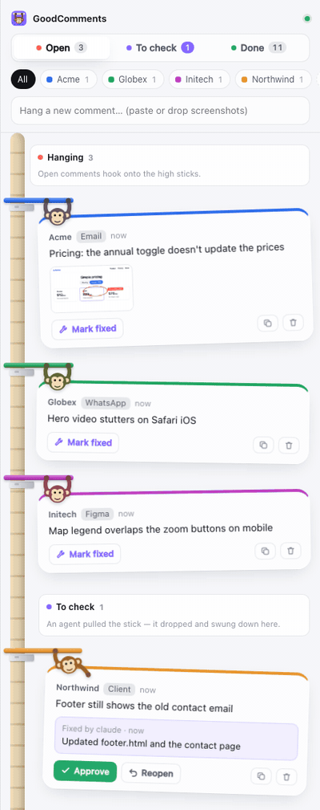

# GoodComments

[](https://glama.ai/mcp/servers/sdezubiria/goodcomments)

Feedback tracker for all your projects, hung on a line at the right edge of your screen.
Every comment goes **open → fixed → done**: agents (or you) fix, you check and approve.

<p align="center"></p>


No dependencies: Node ≥ 22.13 (built-in SQLite) and, for the edge panel, Xcode.

## Install (macOS)
```bash
brew install sdezubiria/goodcomments/goodcomments
```
or the one-line installer:
```bash
curl -fsSL https://raw.githubusercontent.com/sdezubiria/goodcomments/main/install.sh | sh
```
Homebrew installs `gc`, builds the menu bar app (open it with `open "$(brew --prefix goodcomments)/libexec/mac/build/GoodComments.app"`) and adds a `brew services` entry for the server. Releases: [GitHub releases](https://github.com/sdezubiria/goodcomments/releases).

Downloads GoodComments into `~/.goodcomments/app`, adds `gc` to `~/.local/bin`, builds the menu bar app into `~/Applications` and registers the MCP server with Claude Code if it's installed. Run it again to update. Needs Node.js 22.13+ and Apple's Command Line Tools. The website lives in [`docs/`](docs/index.html).

## Run from a clone

```bash
npm start                  # server + board at http://127.0.0.1:4477
npm link                   # puts `gc` on your PATH
npm run mac                # builds mac/build/GoodComments.app
open mac/build/GoodComments.app
```

The Mac app lives in the menu bar (speech-bubble icon). Rest the pointer on the right edge of the screen and the column slides in; ⌃⌥C toggles it. The 📌 button in its header keeps it open, and — minimizes it (a kept-open panel leaves a sliver at the edge; hover it to bring it back). Drag the panel's left edge to resize it. It starts the server for you if needed.

- **To check, at a glance:** the number next to the menu-bar monkey is how many comments wait in To check. When an agent (or anyone else) marks one fixed you get a notification with the comment and the fix note; click it and the column opens on that card. Your own moves in the panel don't notify you.
- **Capture from anywhere:** ⌃⌥N opens a small "new comment" window near the top of the screen: type, pick a project (it remembers the last one), ↵ hangs it, esc closes it. Select text in any app and choose **Services → Send to GoodComments** to open it with that text filled in. (If the Services item doesn't show up, open the app once from `/Applications` or run `/System/Library/CoreServices/pbs -update`.)

## The board
Every state lives on one column: comments hang from monkeys on a trunk (open), drop to "To check" when fixed, and fall onto the pile at the bottom when you approve them. Drag and throw the monkeys on the pile; poke the ones on the trunk.

**Search** hides behind the magnifier in the column's header (next to Settings), so it never gets mixed up with the comment box. Click it or press `/`; it stays open while it holds text and tucks away when you clear it (esc) or leave it empty.

**Edit a comment** with the pencil on its card, the `e` key, or a double-click on its text: change the words, the project, *Where* and *From*, remove attachments (✕), draw on a screenshot (it saves a marked-up copy in its place) or add new ones (camera, paperclip, paste, drop). ⌘↵ saves, esc cancels, ⌘Z undoes it. Each save adds one history line saying what changed. From the terminal: `gc edit <id> -b … -p … -l … -s …` and `gc detach <attachment…>` (attachment numbers are in brackets in `gc show`).

**Keyboard** (when you're not typing in a field): `j` / `k` move a focus ring between cards, `↵` opens or closes the card, `e` edits it, `a` approves it (in To check), `f` marks it fixed, `r` reopens it, `/` searches (filters the cards by text), `esc` clears the focus and closes the search. Also: `n` new comment, `1` `2` `3` jump to Open / To check / Done, ⌘Z / ⌘⇧Z undo and redo moves. In the Mac panel, ⌃⌥C opens it with the cursor in the composer: press esc (or click the column) first.

**Open where it is:** a card whose *Where* is a URL gets an **Open** button. If it's a file in the project's folder (`src/header.php:42`, `./notes.md`), **Open** shows it in your editor: set `GOODCOMMENTS_EDITOR` (e.g. `code`, `cursor`, `zed`, `subl` — these jump to the line) before starting the server, or it uses macOS `open`. Only files inside the project's folder open.

**Ask Claude:** open cards get **Ask Claude** when Claude can tell where to work: the project's folder, or — with no folder — the git repo an absolute location (`/Users/me/site/header.php:42`) is in. It opens a new Claude Code session in the [Claude app](https://claude.com/download) (`claude://code/new?folder=…&q=…`), in that folder, with the comment filled in as its task: send it, then watch and steer it. The task tells Claude to work out the rest of the environment from the comment (the files or pages it names, how the project is built and deployed, local app vs live site) before changing anything. The session uses your GoodComments MCP server (or `gc`) to mark it fixed, and the card drops to To check by itself; until then it shows where the session was opened, and **New session** opens another. Needs the Claude app installed and signed in, and GoodComments added to Claude Code (`claude mcp add goodcomments -s user -- node /path/to/GoodComments/bin/gc.js mcp`).

## Cleaning the pile
Click **🧹 Clean up** on the pile (or `gc clean`) to archive the done comments: they leave the board but stay in the database. ⌘Z (or `gc restore <ids>`) brings them back; `gc list -s done --archived` shows them.
To do it automatically, open **Settings** (the gear in the column's header) and pick how long approved comments stay on the pile: 1 day, 3 days, a week, two weeks or a month. The server checks every hour (`PATCH /api/settings {"auto_clean_days": 7}`; 0 turns it off).
Settings also has **Appearance**: same as macOS, light or dark (it applies to the panel, the ⌃⌥N window and any open browser tab).

**Language**: English or Spanish (Español), or the same as macOS / your browser. It covers the board, the ⌃⌥N window and the Mac app's menus and notifications; the `gc` CLI and the agent tools stay in English. What people write is never translated.

## Projects
```bash
cd ~/Code/my-repo && gc project add "My repo" --path .
```
Or use **+ Project** in the column (double-click a chip to edit). With a path set, agents and `gc` inside that folder pick the project automatically.

## Screenshots and files
- **Take one and draw on it:** press ⌃⌥S (or the camera button), pick an area of the screen, then mark it up with pen, arrow, box, highlighter or text and attach it. Click any pending screenshot to draw on it too.
- **Paste, drop or attach:** ⌘V, drag files anywhere onto the column (dragging to the screen edge opens it), or use the paperclip. Images, PDFs and documents (Word, Excel, text, zip…) are welcome; web pages, SVGs and scripts aren't.
- **From the terminal:** `gc add "text" -f shot.png` or `gc attach 12 shot.png spec.docx`. Agents get images from `get_comment`.
- Screenshots are made small before they're stored: at most 2000 px on the long side, as WebP (JPEG in Safari and the Mac app), unless the original is already smaller. Agents' screenshots (`mark_fixed` files, `gc attach`, `gc fix -f`) are shrunk the same way on a Mac, as JPEG. Animated GIFs, PDFs and other files go as they are.
- Files live in the database (8 MB max each). Screenshots are deleted automatically, by default 3 months after their comment is cleaned up. Settings → *Delete screenshots automatically* turns it off, or sets how long (any number of hours, days, weeks, months or years) and from when: the clean-up, approving the comment, or attaching the screenshot (any comment, open ones too). A rule that would delete screenshots right away says how many and asks first. The comment keeps a history line saying so, and the database is compacted afterwards.

## Agents
See [AGENTS.md](AGENTS.md) (also served at `/agents.md`). Register the MCP server once:
```bash
claude mcp add goodcomments -s user -- node /path/to/GoodComments/bin/gc.js mcp
```
Agents can list, add, note and mark comments **fixed**; only you mark them **done**.

## Layout
| path | what |
|---|---|
| `server/db.js` | all queries (projects, comments, history, attachments) |
| `server/sql.js` | storage: local SQLite at `~/.goodcomments/goodcomments.db` (`GOODCOMMENTS_DB`) |
| `server/local.js` | Mac-side actions: open a file in your editor, run Claude Code on a comment |
| `server/index.js` | JSON API, live updates (SSE), serves the web column |
| `server/client.js` | HTTP client used by the CLI and MCP (auto-starts the local server) |
| `server/mcp.js` | MCP server over stdio |
| `bin/gc.js` | CLI |
| `web/` | the column UI (vanilla HTML/CSS/JS) |
| `mac/` | Swift/AppKit edge panel hosting the column |
